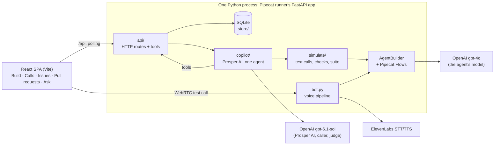

# Solution

## Summary

**The problem.** Prosper's deployment team does two jobs by hand: it turns a
clinic's written guidelines into a voice agent, then keeps fixing that agent
as problems show up, some flagged by the clinic, others hidden in call data
that someone has to read.

**The idea: treat the voice agent like code.** A coding agent fixing a bug
first writes a failing test, makes the smallest change that fixes it, and
reruns all the tests; a person reviews and merges. The same loop runs here:

> issue → a test that reproduces it → the smallest change → the whole suite
> → merge as a new version

Prosper AI proposes each change; a person merges it. Nothing reaches callers
except through a merge.

**What was built.**
- A graph editor for Pipecat Flows JSON. Each step is a card, edited in
  place. A voice test call lights up its path on the graph.
- Versions and pull requests. Every change (a hand edit, a setup, a fix) is
  made inside a pull request, on its own copy of the agent. Merging makes
  that copy the next live version.
- Tests: simulated calls in text, run on the real Pipecat pipeline, 3 times
  each on every change. A failing test blocks the merge.
- **Setup with Prosper AI.** The person gives the clinic's guidelines
  (notes, PDF, Word). Prosper AI asks about what they leave open, then writes
  the agent, the rules (each quoting the line it comes from) and the tests,
  runs the suite and checks its own work against the result (the
  self-check). All of this happens in PR #1.
- **Calls and issues, like Sentry.** Simulated callers phone the live
  version. Prosper AI reviews every call, and what goes wrong is grouped by
  problem into issues, the way Sentry groups error events: one issue, many
  calls, so you see how often callers hit it. Issues can be snoozed,
  ignored or resolved, and one resolved by a fix that shows up again in a
  later version reopens ("Came back in v3"). People can report issues too,
  for example by pasting a clinic's email.
- **Fix with Prosper AI** on any issue: the loop above, inside a pull
  request.

**Prosper AI is one agent**, with one set of tools, in the Ask Prosper AI
chat and in a pull request's conversation. In the chat it can look up
anything in the product and do what the person can do (open issues, fix, run
tests, merge…), but only after the person clicks to confirm. In a pull
request it edits the pull request's copy directly: nothing there reaches
callers before a person merges. Setup and Fix are not separate programs:
they are how its work in a pull request starts.

**Measured** on the final code. Every agent was built from the same sample
guidelines, always picking the first option at every question. The samples
are small. "Green" means no test fails, so the pull request can merge.

| | Result |
| --- | --- |
| Setup reaches green on its own | **5/5**, median 76 s and USD 0.43 |
| Issues found in 24 simulated calls | **6 issues: 5 real, 1 debatable, 0 false, 0 duplicates** |
| Fix reaches green (mergeable) | **5/6**, median 114 s and USD 0.74 |
| The issue's own test passes all 3 runs (3/3) after the fix | **5/6** |

**Key decisions** (the full reasons are in Decisions & trade-offs).
- Every change goes through a version and a pull request. A change that a
  model wrote must be tried before a patient hears it.
- Tests are text calls on the real engine, so what we test is exactly what
  callers get.
- Each test runs 3 times. 2/3 is flaky: shown in yellow, it does not block
  the merge. The agent never answers the same way twice, so one run proves
  little.
- Prosper AI is one agent on the **OpenAI Agents SDK**, with the guarantees
  in its tools. What must always hold (ask before drawing, reproduce before
  changing, never rewrite the issue's test, a person merges) is checked in
  code by the tools, not left to the prompt.
- Calls are simulated on the live version, not taken from canned examples,
  so the issues found are about the real agent as it is now.

**Next.** Count a problem as reproduced when it fails even once in 3 runs.
Treat a flaky test about the same duty as the issue as part of the fix. Use
real call data. Run only the tests that a change can affect. Add access
control and handle patient data properly.

## Scope

**In** (what the two manual jobs need, end to end):
- Build: the graph editor, validation that names the broken step, a voice
  test call. The change loop: versions, pull requests, tests, and a merge
  that failing tests block.
- Prosper AI: setup from guidelines, call review into issues, fix, tidying
  a reported issue, and Ask with tools.

**Simulated, on purpose:**
- *Production calls.* There is no call data and no phone line. "Play calls"
  sends 10–12 simulated callers to the live version, through the same text
  pipeline the tests use, and the UI says so. *The clinic*: a person pastes
  its complaints into New issue.

**Out, and why:**
- Accounts, permissions, several clinics: the person using the builder is
  "you". Neither manual job needs them.
- Telephony and real patient data: they need compliance work that a demo
  cannot show.
- Voice-level testing (speech recognition errors, interruptions, latency):
  the tests check the graph and the prompts, not the audio.
- A visual polish pass, mobile, i18n.

## Product walkthrough

One top bar on every screen: the agent, its version, the sections Build ·
Calls · Issues · Pull requests, Test call and Ask Prosper AI.

1. **New agent → Build it with Prosper AI.** You give a name, notes and
   files. PR #1 opens and Prosper AI works in its conversation. It first
   asks up to three questions with options (median 6 s). The graph appears
   in Build within half a minute (median 27 s from the start, answering at
   once), then the rules, the tests and the checks. "Merge & go live as v1".
2. **Build.** The graph, edited in place: every text on a card is an input.
   Rules and tests sit in a side rail. A voice Test call draws its path on
   the cards.
3. **Calls.** "Play calls" runs a batch of simulated calls on the live
   version. Each call shows its transcript, its path and the checks Prosper
   AI applied; a failed check is quoted on the turn where it failed.
4. **Issues.** An inbox like Sentry's: findings grouped by problem into
   issues (Safety, Booking, Experience), each with its calls and how many.
   You can snooze an issue (for a day, a week, or until a new version is
   live), resolve or ignore it, write a New issue, Tidy it with Prosper AI,
   or **Fix with Prosper AI**.
5. **Pull request.** Three tabs. Conversation: Prosper AI's steps as they
   land (the test fails 0/3 on v1, the change, the checks). You can write
   to Prosper AI there ("the confirmation must always give the address"),
   and it goes on working on the same copy. Changes: a diff in words
   ("Changed when Collect details moves on"). Checks: each test's score
   (3/3, 2/3, 0/3). Merge as v2; the issue then says "Fixed in v2 by PR #8".
6. **Ask Prosper AI** (⌘J) on any screen. "Why did Nadia Williams not get a
   nurse callback?" gets an answer with links. "Have her ask if it's a first
   visit" gets a card (Do it / Cancel) to open a pull request, where the
   same agent then makes the change.

## Architecture



**Backend modules.**
- `agent_builder/`: `AgentConfig` and `AgentBuilder`. The builder also adds
  the rules to the prompt, so a voice call, a test and a simulated call all
  get the same prompt.
- `api/`: HTTP routes on the runner's own FastAPI app (one process, one
  port, one origin). `api/tools.py` is Prosper AI's one set of tools; each
  act calls the same route as the UI.
- `store/`: SQLite via stdlib `sqlite3`, one module per kind of thing
  stored. Every write takes the database lock first (`BEGIN IMMEDIATE`).
- `simulate/`: a text call on the real pipeline, the simulated caller, the
  checks, the suite.
- `copilot/`: Prosper AI. `agent.py` (the one agent and its run),
  `work.py` (the guards on its work in a pull request), `facts.py` (what it
  reads first), `llm.py` (the one place that talks to a model),
  `artifacts.py` (the shape of each answer, and its checks), `calls.py` and
  `audit.py` (call review and grouping), `tidy.py`, `files.py`. The prompts
  are in `prompts/*.md`: one shared, one for pull requests, and three
  **briefs** (setup, fix, change).

**Data model** (10 tables).
- An agent has **versions** (frozen copies) and **pull requests**, each
  with its own copy that starts from a **base version**.
- A copy is four JSON columns: `config` (the Pipecat Flows agent), `layout`
  (card positions, by step name), `rules` and `tests`.
- A pull request also stores where Prosper AI's work on it stands (its
  state, the questions it asked and their answers, what it has done).
- A **run** is the latest suite result on one copy. It stores a
  **fingerprint**, a short hash of the copy's config, rules and tests, so
  any change to them makes the run stale.
- **Plays** are batches of simulated **calls**. The problems Prosper AI
  finds on calls are **findings**, grouped into **issues**.
- **Test calls** are the voice calls a person makes from Build, kept apart
  from production calls.
- **Chats** are Ask Prosper AI conversations.
- Issues and pull requests share one counter per agent, so "Issue #4" and
  "PR #8" never collide.

**How tests run in text on the real engine.** A text call builds the agent
with the same `AgentBuilder` as a voice call, starts the same `FlowManager`
through one `start_flow` function shared with `bot.py`, and uses the same
`OpenAILLMService`. The only difference is that there is no audio:
- The caller's lines go in as text messages.
- A small processor sits where TTS would be and collects what the agent
  says and the steps it enters.
- Transitions are function calls, so the agent's turn ends when the model
  responds with no function call.
- The path comes from the same reporter as a voice call's path.

A model plays the caller, from a paragraph that describes who they are.
Each test has a few checks, one per line, of two kinds:
- A **path check** names a step or a field ("Reaches Nurse callback", "date
  of birth is recorded", "Ends the call"). It is decided from the path:
  exact, and free.
- A **judged check** is any other line. A model (the **judge**) reads the
  transcript and answers yes or no, with one line saying why.

**How Prosper AI's work runs.** In a pull request, Prosper AI works in
**turns**: the agent works until it is done, asks the person something, or
reaches its limit.
- Turns run in a thread pool of 4 workers inside the server process.
- Each edit is written to the pull request's conversation as it happens.
- The UI polls every 1–1.5 s while something runs. A live stream was not
  worth its moving parts for work that takes one to three minutes.
- Every turn starts from the pull request as stored: the guidelines and the
  answers, the copy and how its tests went, where the work stands, the
  conversation. Nothing is kept in memory between turns, so a question ends
  a turn and its answer starts the next, and a turn cut by a restart is
  picked up by the next message.
- Suites run on their own event loop, in their own thread, 12 calls at a
  time, so voice calls on the server's main loop never wait behind them.
- A new change cancels the run in progress.

## Prosper AI

All of our own model requests use one model, `gpt-6.1-sol`, set by one
variable (`PROSPER_MODEL`), at low reasoning effort, through the Responses
API. The voice agent keeps the model named in its own JSON (`gpt-4o`), and
so do its tests.

**One agent, two places.** Prosper AI is one agent on the OpenAI Agents
SDK. It works in two places:
- **In Ask Prosper AI** (the chat). Reads run at once. Every act ends the
  message with a card, and runs only when the person clicks. At most 8 tool
  calls per message; past them, it answers with what it has. An answer is
  at most 600 characters, and every link must point to something that
  exists.
- **In a pull request's conversation.** Here it works on the pull request's
  copy, with no card: nothing in a pull request reaches callers before a
  person merges it, so the pull request is the review. A turn makes at most
  30 model requests (a setup takes about 12, a fix about 10).

"Build it with Prosper AI" and "Fix with Prosper AI" open a pull request and
start the agent with a **brief**: a short text that says what the work is
and in what order. There are three: setup, fix, and change (for a change
asked in the chat, or a message on a person's own pull request). A message
or an answer in the conversation is the next turn of that work.

**The tools** (38, in `api/tools.py`):

| Kind | Where | What |
| --- | --- | --- |
| **Read** (9) | Chat and pull request | Search and read calls, issues, pull requests, tests, the agent and its rules, versions. They run at once. |
| **Act** (11) | Chat only, each after a click | Open, tidy or fix an issue; open, close, reopen or merge a pull request; add a rule or a test; run tests; play calls; snooze, resolve, ignore or reopen issues. |
| **Work** (18) | Pull request only, no card | Draw a new agent whole; add a step; set a step's task; set or remove when it moves on; add or remove a field; add or remove rules; add, rewrite or remove tests; ask the person questions with options; reproduce on the base version; run all the tests or one; read the results and a test's call. |

**Every edit is checked before it is written**, by the same `AgentBuilder`
validation as a person's save, plus Prosper AI's own:
- a rule's quote must appear word for word in its source;
- a test's "Reaches X" / "X is recorded" must name a real step or field;
- length limits: a step's task is at most 3 sentences, a rule is one
  sentence, a test has 2–4 checks with at most one judged check;
- no stored names (`collect_details`) and no graph words ("node", "edge")
  in what a person reads.

A refused edit goes back to the model as the tool's error, with the sentence
that says why, and the model tries again.

**The guarantees are in code** (`copilot/work.py`), not in the brief, so no
wording of a brief can get past them. There are seven:
- A setup asks first (0 to 3 questions, each with 2 or 3 options) and draws
  nothing until every question has its answer.
- A setup never takes a test out.
- A setup runs its tests only with 5 to 7 of them, and with every answer
  quoted by a rule.
- A fix changes nothing in the copy before its test has failed on the base
  version, or the person said to go on. That question is asked in code, so
  the go-on is always the person's. A change asked in the chat starts the
  same way: first a test that shows the agent does not do it yet.
- A fix never rewrites or takes out the issue's own test.
- A fix changes 2 steps at most.
- A turn runs the whole suite 3 times at most: the first run and 2
  **rounds**. A round is one self-check: Prosper AI reads the failing
  tests, changes something, and the suite runs again.

Merging is never a tool in a pull request; in the chat it is an act with a
card. The honest-green warnings (Testing, below) are the store's, the same
whichever way the merge comes.

**What a setup does.** First, questions about what the guidelines leave
open. Then the agent, drawn whole. Then the rules: each sits on its step
and quotes a line or an answer. Then the tests (5–7). Then the suite. Then
the self-check, which gives each failing test one verdict: the agent is
wrong (make the smallest change), the test asks for more than the
guidelines (rewrite it, and say why), or the guidelines leave it open (ask
the person).

**What a fix does.** It writes a test from the issue's calls (or from the
report) and runs it 3 times on the version those calls used. To count as
reproduced, the test must fail: pass fewer than 2 of 3. If it passes, it
makes one sharper try; if that also passes, it asks the person whether to
go on. Then the smallest change, in this order of preference: a rule on the
step where it goes wrong, then a plainer task or condition, then a new way
on or a new step. Then the whole suite. Edits are written at once but said
under Prosper AI's next message, so a fix reads as three cards: reproduced,
the proposed change (its lines and "See the diff"), and the checks passing,
with the test's score before and after.

**Single requests stay single.** Work that judges one input and needs no
tools is one Structured Outputs request. Code checks the answer; when it
refuses it, it sends it back to the model with the sentence that says why,
at most 3 attempts in all.

| Request | What it does |
| --- | --- |
| **Callers of a batch** (1) | Writes 10–12 callers from the guidelines: mostly routine, at least 2 edge cases. They call the live version 1.5 s apart. A call is cut after 12 caller turns. |
| **Review of a call** (1 per call) | Applies 3–8 checks, taken from the rules, the guidelines and the clinic's answers. Each failed check names its turn and quotes it (code checks the quote word for word). |
| **Grouping** (1 per call with findings) | Adds the finding to an issue already tracked, or opens a new one. One call at a time, so a new problem is opened only once. |
| **Tidy / title** (1 each) | For a reported issue: a plain title (at most 60 characters, written when the title is left empty), its step, its severity, and up to 3 calls that show it. You see it before and after, and you keep it or not. |

**Permission cards** (Ask Prosper AI). An act never runs from the model;
the message ends with a card that says what will happen, in the product's
words ("Merge PR #19 as v4 · Calls will use v4 from then on · 9 of 11 tests
pass, 2 flaky · Resolves Issue #10"), with Do it and Cancel. Do it calls the
same route the UI calls (`report_issue`, `merge_pull`…); when the route
refuses (404, 409, 422), Prosper AI gets the refusal as the tool's answer.
The card is built after running the same checks, before anything is done.
So "merge it", on a pull request with failing tests, gets the answer
"PR #18 cannot merge: 2 tests are failing", and no card. A card waiting for
its click is saved with the conversation, so it survives a restart.

**What it cannot do.**
- Change the live version without a merge, or merge without the person.
- Edit a rule in place (it removes one and adds another).
- Rewrite the test that reproduces the issue it is fixing.
- Compare two versions in one answer.
- A fix touches at most two steps.

## Testing & reliability

**The merge rule.** Each test runs 3 times. 3/3 passes. 2/3 is flaky: it
shows in yellow and does not block. Anything lower fails and blocks the
merge: the server refuses with a 409 and the UI disables the button. The
merge also needs the latest run to match the copy as it is now (same
fingerprint).

**Why 3 and 2/3.** A simulated call never goes the same way twice, so one
run proves little. When I required 3/3, most real suites turned red, on
calls that went right two times in three. More runs would multiply the cost
of every change.

**Honest green.** Green can be weak. A fix's own test can end at 2/3, so
the problem may still happen one call in three. And a fix can go in with no
reproduction, after the person says to go on. I rejected requiring
3/3. When one call in three fails, the cause is often the judge, not the
agent. And a hard rule would push Prosper AI to bend the agent until a noisy
check gives way. Instead:
- When a fix's own test is at 2/3, or was never reproduced, a warning shows
  at the top of the conversation, in Checks and on Merge. Merging then asks
  for one confirmation (the API enforces the same rule). The issue keeps a
  record of what was confirmed.
- When a fix's own test is at 2/3, Prosper AI takes one more round to reach
  3/3.
- When a test was already flaky on the base version, it is run again once.
  Prosper AI does not change the agent for it.
- Symptoms that are not routed as the guidelines say are always Safety.

**The evaluation** (2026-10-21, the final code at the merge of #23, through
the app's HTTP API, first option at every question, USD 9.77 in total). A
fix merged with a warning was confirmed, as the person would; "green" means
no test is red.
- **Setup: 5/5 reached green on their own**, and were merged. 29/32 tests
  ended at 3/3, 3 at 2/3. No self-check rounds in any of them. Medians:
  questions 6 s, graph 27 s, final checks 76 s, USD 0.43. A setup is about 6
  requests to Prosper AI's model, about USD 0.05; nearly all the rest is the
  suite.
- **Calls → issues: 24 calls, 7 with findings, 6 issues: 5 real, 1
  debatable, 0 false, 0 duplicates.** I read each one against the
  guidelines, the clinic's answers and the transcript. The debatable one
  applied "confirm the date, the time and the location", written for
  bookings, to a cancellation. Symptoms without a nurse callback came out
  as Safety.
- **Fix: 5/6 reached green.** 2 merged with no warning, 3 after confirming
  a warning (2 not reproduced, 1 with its own test at 2/3). 4/6 reproduced
  the problem first. The issue's own test ended at 3/3 in 5/6. Median 114 s
  (103–196), USD 0.74 (0.53–2.09). The one that did not reach green was
  blocked by a test that was already flaky on the base (see Limitations).
- **A reported issue** (a clinic's email, no calls): not reproduced (3/3
  twice), the person said go on, merged with the "not reproduced" warning.
  109 s, USD 0.63.

These are small samples (5 setups, 6 fixes): signs, not rates. The one fix
that did not reach green says more through its cause than through the count
(see Limitations).

**Unit tests**: 364 backend (pytest) and 214 frontend (Vitest), all
passing. None of them reaches OpenAI. Prosper AI runs on the real SDK with a
scripted model, and the text call runs Pipecat's OpenAI service on a
scripted stream.

## Cost & latency

All measured on real runs; prices from `copilot/llm.py`.

| What | Time | USD |
| --- | --- | --- |
| Setup (to final checks) | median 76 s (69–78) | median 0.43 (0.34–0.50) |
| A batch of 12 simulated calls, reviewed | 71–81 s | 0.31–0.45 |
| One call review | | about 0.01 |
| Fix (to final checks) | median 114 s (103–196) | median 0.74 (0.53–2.09) |
| Suite, 5 tests × 3 calls (sample agent) | 26 s | about 0.25 |
| Ask Prosper AI answer | 3–15 s | 0.01–0.02 |
| Tidy a reported issue | | 0.003 |

Most of the money goes to suites, because gpt-4o resends the whole
conversation on every turn. In a fix, Prosper AI's own requests cost USD
0.11–0.17, and each round runs the whole suite again: the fix with 2 rounds
cost USD 2.09. A stuck call is cut after 12 caller turns (one had cost USD
0.10). I measured low reasoning effort against the default: at the default,
a request could think for minutes and spend its whole token budget without
writing anything.

## Decisions & trade-offs

**Versions and pull requests for an agent.**
Alternatives: edit live and keep versions to roll back; one draft per agent
and a "publish" button. Why: a change proposed by a model must be tried
before a caller hears it, and two proposals (a fix and a hand edit) must be
able to exist at the same time. Cost if wrong: more ceremony for a one-word
edit. A pull request left behind by a newer live version needs an "Update":
the browser replays its changes on the new version, and the server checks
the result.

**Tests are text calls on the real Pipecat pipeline.**
Alternatives: a simulator of our own; voice calls with a synthetic caller.
Why: a simulator of our own would test a copy of Pipecat Flows, not Pipecat
Flows. Voice is slow, paid per second, and speech recognition errors make
results flaky. Cost: no audio problems are tested (mishearing,
interruptions, latency).

**3 runs; 2/3 is flaky and does not block; a weak fix gets a warning.**
Alternatives: 1 run; 3/3 required; more runs. Why: see Testing. Cost: a
real problem that shows up in one call out of three can be merged. The
warning and the confirmation make that a decision, not an accident.

**Rules live next to the agent JSON, and `AgentBuilder` adds them to the
prompt.**
Alternatives: edit the step's text; a `rules` field inside the JSON. Why: a
fix is usually one sentence that must say where it came from and be easy to
take out, and the JSON keeps Pipecat's format. Cost: what the model is told
lives in two places (the cards and the rules rail).

**Setup asks first and writes the tests last.**
Alternative: draw the agent first, ask after. Why: when questions came last,
an answer turned into a rule after the tests, and the rule contradicted them
(the clinic wanted a date of birth that the test callers did not have). The
self-check then blamed the agent. Cost: the person waits for the questions
before seeing anything (about 6 s).

**Prosper AI is one agent, and the guarantees live in its tools.**
Alternatives:
- *Fixed pipelines.* Setup and fix as fixed chains of structured
  requests, a message in a pull request as one request that rewrites the
  whole agent, and only the chat as an agent. That makes four mechanisms,
  each with its own prompts, its own retry and its own way to say what it
  did. Every fix to how Prosper AI behaves would have to be made four
  times. And "make the greeting shorter" or "the third test fails" is the
  same work as a fix's second round; two code paths for it drift apart.
- *Our own loop* for the agent (the request, the tool calls, the limit and
  the waiting card). Small, but a reviewer has to read it line by line to
  trust it.
- *A general framework* such as LangGraph: a second vendor and vocabulary
  on top of OpenAI's, for one agent with plain function tools.

Why one agent on the Agents SDK: the fewest pieces. The SDK is OpenAI's
own, on the same API and model, and it has what Prosper AI needs built in:
function tools, approval before a tool runs (the cards), a run state that
can be saved (so a waiting card survives a restart), a turn limit, and a
fake model for tests. What a fixed order would guarantee is checked in
code by the tools instead (the seven guarantees in Prosper AI). What a
reviewer has to read to trust Prosper AI is one run loop and one list of
tools with their guards. Cost: the guards make the tools the largest file in
the backend (`api/tools.py`, 1,408 lines). The guards stop a wrong step, not a missing
one: the order of the work still rests on the brief (one setup handed over
with a test failing and a round unused, and the brief was fixed after). And
one more dependency, held at an older version so the voice stack stays on
the Pipecat it was checked on.

**Inside a pull request edits need no card; outside one every act has a
card; a person always merges.**
Alternatives: a card for every edit too; a chat that edits the agent
directly; a chat that can only read and offer a pull request. Why: a pull
request's copy reaches no caller before a merge, so the pull request is
the review, and a card per edit would only slow it down. Outside one, an
act changes something real, so the person clicks. The person should be
able to do everything from the chat that they can do in the product, and
each act calls the UI's own route, so there is one implementation. A change
asked in the chat becomes a pull request, with a test first. Cost: a click
for every act in the chat, even cheap ones that are easy to undo.

**Issues work like Sentry.**
Alternatives: one row per bad call; a list of flagged calls to read. Why:
the deployment team's real question is "what is broken, and how often", not
"which calls went wrong". Grouping by problem gives one thing to fix per
problem, a count that shows priority, and a lifecycle people already know
from Sentry: snooze, ignore (it keeps counting), resolve, and a regression
reopens an issue a fix resolved when it shows up on that version or a later
one; a call answered by an older version leaves it resolved. Cost: the
grouping is a model's judgment, so two issues can be the same problem (0
duplicates in the evaluation, on a small sample).

**A fix tries to reproduce first, but does not require it.**
Alternatives: always fix straight from the issue; refuse to fix what does not
reproduce; replay the issue's calls. Why: a failing test is the only proof
that the problem was real and that it is gone, and it stays in the suite, so
the problem cannot come back unseen. So Prosper AI always tries first. But
some problems will not show in 3 runs (one call in a hundred), and blocking
those would leave real issues unfixed. When the test does not fail, Prosper
AI says so and asks; if the person says go on, it makes the change anyway,
and the pull request and the merge say "Not reproduced on vN: nothing shows
this change fixes it". The person decides with that in view. A whole recorded
call cannot be replayed as a test, because its caller cannot react to the
agent's new answers (starting a test from its turns up to the bad moment is
next, below). Cost: a fix costs a suite (or three), not one request; and a
rare problem gets a change without proof, only a warning.

**Simulated callers on the live version, each call reviewed.**
Alternative: seeded example calls. Why: canned calls describe some other
agent; simulated calls change when the agent does. Cost: simulated callers
are cooperative, and they only test what Prosper AI thought to send.

**Models: the agent keeps gpt-4o; ours is gpt-6.1-sol at low effort.**
Why: what is tested must be what calls run. Our work needs judgment, not
speed. Cost: the newest model is the most expensive; one variable switches
it.

**One backend on Pipecat's FastAPI, SQLite, a Vite React SPA.**
Alternatives: a second service; Postgres; Next.js; Streamlit. Why: one
process, one port, nothing to set up, and React Flow for the graph. Cost:
Prosper AI's turns run in the server process (a restart cuts the turn in
progress; the next message picks it up). There is no migrations tool and
no horizontal scaling.

**The graph is edited in place, laid out by ELK with one port per edge.**
Alternatives: a side inspector; dagre. Why: the card is what a person
reads, and one port per edge keeps wires from crossing. Cost: ELK is 1.4 MB
(loaded on first use), and the cards must be measured before the layout
runs.

## What is simulated vs real

| Real | Simulated or missing |
| --- | --- |
| Pipecat Flows engine, `AgentBuilder`, the agent on gpt-4o | Production calls: simulated callers in text |
| Voice test call (WebRTC, ElevenLabs STT/TTS) | Call length (estimated from words; no audio) |
| Every Prosper AI request (OpenAI) | The clinic: complaints pasted by a person |
| Tests, merge gate, versions, pull requests | Accounts: everyone is "you" |
| Cost counted from real token usage | Phone line, patient records, calendar |

## Limitations

The loop works end to end and is measured. The evaluation also showed
where it is weak:
- **"Not reproduced" when the agent fails 1 call in 3.** To count as
  reproduced, the issue's test must fail 2 or 3 runs of 3 on the base
  version. Two real issues (one of them Safety) failed 1 run in 3, twice:
  the problem was there, but it did not count as reproduced. They merged
  with a "not reproduced" warning that overstates the doubt. This does not
  match the merge rule, where 2/3 after a fix means "the problem may still
  happen".
- **A test already flaky on the base that turns red blocks a fix.** One
  fix's own test went from 1/3 to 3/3, but another test, already 2/3 on the
  base, fell to 1/3 twice, so the merge was blocked. Prosper AI stopped,
  because the rule is to leave base-flaky tests alone. But that test checks
  the same duty as the issue, so its fall was a sign the fix was not
  complete, and the rule hid it. In another fix, the same kind of test
  stayed at 2/3 and the fix merged: which happens is luck.
- **The reproduce test can ask for more than the issue.** For "offers a day
  that is not a Tuesday", the test's check was "offers Tuesday or Thursday
  without inventing dates". Two of its three calls on the base gave correct
  dates and still failed, so it read 0/3 instead of 1/3.
- "Green" is still a model's opinion: a simulated caller and a judge model.
  A judged check can be wrong; its reason is always shown.
- Every number above comes from a small sample.
- The same first option, picked five times, gave five different policies
  (here, what to ask a caller to identify them). The questions are right;
  the options vary.
- The guards stop a wrong step, not a missing one: the order of the work
  rests on the brief.
- Each change runs the whole suite on gpt-4o. That is fine at 7–14 tests,
  not at hundreds.
- Ask rebuilds its facts for each answer from the latest 30 calls. With
  thousands of calls, it would need to search first.
- Prosper AI's work lives in one process: no queue, no retries across
  machines. No access control, per-user audit trail or patient-data
  handling.

## What I would do next

The loop works and is measured; these are the next things to polish.

1. **Reproduced = fails at least once in 3.** It matches the merge rule,
   and the two real issues above would have counted as reproduced.
2. **A base-flaky test about the same duty is part of the fix.** Leave a
   flaky test alone only when it checks something else; when it checks the
   issue's own duty, Prosper AI should work on it.
3. **A reproduce test that asks only what the issue says**, so that it
   fails on the calls that show the problem and on no others.
4. **Rare problems**: start the reproduce test from the real call's own
   turns, up to the moment it went wrong, so a problem that shows once in a
   hundred calls is replayed at that moment on every run, and only the
   agent's next answers are new.
5. **Real call data**: bring in recorded calls and transcripts instead of
   Play calls. The review and the grouping already take a transcript.
6. **Cheaper iteration**: while Prosper AI iterates, run only the new tests,
   the failing ones, and the ones whose path goes through a changed step.
   Run the whole suite once, before the merge.
7. **Stronger green**: more runs, only for the issue's own test, and a
   calibration set for the judge.
8. **Production hygiene**: accounts and roles (who may merge), a job queue,
   Postgres, and removing PHI before any model call.
9. **Trust levels**: once people trust them, let cheap acts that are easy
   to undo (snooze, run a test) run without a click.

## How it was built

Small pull requests, each reviewed and merged one at a time (merge commits,
never squash). They were written with a coding agent (Claude Code), under
`AGENTS.md`, with CI and an automated review on every PR. Each decision was
recorded in this file in the PR that made it; that full log is kept at
[solution.md as of #23](https://github.com/encinascarles/prosper-challenge-agent-copilot/blob/ccc03ee/solution.md).

- Setup: [#1](https://github.com/encinascarles/prosper-challenge-agent-copilot/pull/1)–[#6](https://github.com/encinascarles/prosper-challenge-agent-copilot/pull/6), [#9](https://github.com/encinascarles/prosper-challenge-agent-copilot/pull/9) (AGENTS.md, CI, review, worktrees, HTTPS dev link).
- Phase 1: [#7 agents API](https://github.com/encinascarles/prosper-challenge-agent-copilot/pull/7) · [#8 graph editor](https://github.com/encinascarles/prosper-challenge-agent-copilot/pull/8) · [#10 test call](https://github.com/encinascarles/prosper-challenge-agent-copilot/pull/10).
- Phase 2:
  [#11 versions and pull requests](https://github.com/encinascarles/prosper-challenge-agent-copilot/pull/11) ·
  [#12 pull request page](https://github.com/encinascarles/prosper-challenge-agent-copilot/pull/12) ·
  [#13 rules and tests](https://github.com/encinascarles/prosper-challenge-agent-copilot/pull/13) ·
  [#14 setup with Prosper AI](https://github.com/encinascarles/prosper-challenge-agent-copilot/pull/14) ·
  [#15 calls and issues](https://github.com/encinascarles/prosper-challenge-agent-copilot/pull/15) ·
  [#16 fix with Prosper AI](https://github.com/encinascarles/prosper-challenge-agent-copilot/pull/16) ·
  [#17 test calls and single tests](https://github.com/encinascarles/prosper-challenge-agent-copilot/pull/17) ·
  [#18 Ask Prosper AI](https://github.com/encinascarles/prosper-challenge-agent-copilot/pull/18) ·
  [#19 report an issue](https://github.com/encinascarles/prosper-challenge-agent-copilot/pull/19) ·
  [#20 Prosper AI acts](https://github.com/encinascarles/prosper-challenge-agent-copilot/pull/20) ·
  [#21 honest green](https://github.com/encinascarles/prosper-challenge-agent-copilot/pull/21) ·
  [#22 Ask on the Agents SDK](https://github.com/encinascarles/prosper-challenge-agent-copilot/pull/22) ·
  [#23 one Prosper AI](https://github.com/encinascarles/prosper-challenge-agent-copilot/pull/23).

## How to run it

Requires Python 3.11+, [uv](https://docs.astral.sh/uv/) and Node 22+.

```bash
cp backend/.env.example backend/.env   # OPENAI_API_KEY, ELEVENLABS_API_KEY
make install
make dev        # open http://localhost:5173
make check      # lint, 364 + 214 tests (no network), typecheck, build
```

The database (`backend/data/agents.db`, or `AGENTS_DB_PATH`) is created on
first start, with a sample agent in it. To see the loop: New agent → Build
it with Prosper AI (paste a clinic's guidelines) → answer the questions →
Merge → Calls → Play calls → Issues → Fix with Prosper AI → Merge as v2.
